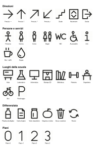

# PIEGA — L’Opificio Digitale

**Apri il sito → https://frmurgia.github.io/wayfinding-mossa/**

Laboratorio di wayfinding della 3a L CAT, IT “Lorenzo Mossa”, Oristano.
Progettiamo la segnaletica della scuola come un **sistema modulare**: tessere e pezzi stampati in 3D **solo come trama** (leggeri, mai pieni), curvati in acqua calda e agganciati a lastre di plastica riciclata fresate a CNC.

PIEGA serve a vedere **prima di stampare** come diventa un pezzo piatto una volta piegato.

## Cosa si fa nel sito

- **Laboratorio** — carichi un file STL o STEP (o scegli una forma del corso), tracci le linee di piega, scegli angolo e raggio della curva e guardi il pezzo chiudersi in 3D.
- **Esempi** — cestino per la differenziata, tessere a clip, appendiporta, cartello appeso, fascia per colonna e altri.
- **Pittogrammi** — 35 segni su griglia 10 × 10 (direzioni, servizi, luoghi della scuola, differenziata, piani), in tessere da 60, 80 o 100 mm.
- **Agganci** — come si tengono insieme i pezzi: arpione, clip a U, gancio ripiegato, pittogramma a innesto, viti.
- **Guida** — percorso del corso, stampa, piegatura, regole di progetto.
- **▶ Presenta** — gli esempi si piegano da soli a schermo intero, per la lezione.

## Come stampare

### 1. Scegli il file

In `esempi/` (o esportando dal sito) ogni pezzo ha due versioni:

| File | Cosa fa lo slicer | Quando usarlo |
|---|---|---|
| `*_pieno-per-slicer.stl` / `*_tessera-piena-per-slicer.stl` | **la trama la genera lo slicer** (metodo 2) | **consigliato** per tessere, cestino, appendiporta: linee continue, quasi nessuna ritrazione |
| `*_da-stampare.stl` / `*_tessera.stl` | la trama è già nel modello (metodo 1) | per i **pallini** e quando ganci e linguette devono essere pieni |

Non scalare i file nello slicer: genera la misura giusta nel sito (le tessere esistono già a 60 e 100 mm).

### 2. Impostazioni — metodo 2 (riempimento dello slicer)

| Impostazione | Valore |
|---|---|
| Materiale | PLA |
| Altezza strato | 0,2 mm (8 strati = 1,6 mm) |
| Strati solidi sopra / sotto | **0 / 0** |
| Perimetri | 2 |
| Riempimento | **Griglia**, 12–20% (passo 6 mm ≈ 15%) — per i rombi: griglia a 45° (Cura: direzioni `[30,150]`) |
| Larghezza linea riempimento | 0,6 mm |
| Ganci e linguette | modificatore con riempimento 100% |

Il sito, in “4 · Esporta”, calcola la percentuale giusta per il passo della trama che hai scelto.

### 3. Impostazioni — metodo 1 (trama già modellata)

| Impostazione | Valore |
|---|---|
| Perimetri | 2, **larghezza perimetri 0,6 mm** (= linea 1,2 ÷ 2: niente riempimenti a pezzetti tra i due perimetri) |
| Spostamenti | **evita di attraversare i perimetri** / combing “dentro il riempimento” |
| Ritrazione | solo quando esci dal pezzo · spostamento minimo 2–3 mm · diretto 0,6–0,8 mm, bowden 3–5 mm |
| Z-hop | **spento** (almeno sul primo strato) |
| Cura | numero massimo di ritrazioni 10 in 5 mm |

### Problemi visti sulle prime stampe

| Cosa si vede | Cosa fare |
|---|---|
| Fili sottili dentro le celle | spostamenti dentro il pezzo, ritrazione 0,8 mm (diretto) / 4 mm (bowden), 195–200 °C, spostamenti ≥ 150 mm/s, filamento asciutto |
| Puntini o “x” agli incroci | cucitura posteriore/allineata, wipe attivo, coasting (Cura), pressure/linear advance calibrato — oppure metodo 2 |
| Trattini lungo linee e bordo | larghezza perimetri = linea ÷ 2 (0,6 mm per linee da 1,2) |
| Anelli attorno al pittogramma | già corretto nei file: riscaricali |

### PrusaSlicer passo passo (stampanti Prusa)

Modalità **Esperto** (in alto a destra). Salva come preset “PIEGA trama” per non perderle.

| Scheda → sezione | Impostazione | Metodo 2 (pieno + riempimento) | Metodo 1 (trama modellata) |
|---|---|---|---|
| Stampa → Strati e perimetri | Perimetri (Perimeters) | 2 | 2 |
| | Strati solidi superiori / inferiori (Solid layers) | **0 / 0** | come da profilo |
| | Posizione giunzione (Seam position) | Posteriore (Rear) | Posteriore (Rear) |
| | Evita di attraversare i perimetri (Avoid crossing perimeters) | ✓ | ✓ |
| Stampa → Riempimento | Densità (Fill density) | 15% (passo 6 mm) | — |
| | Trama (Fill pattern) | Griglia (Grid) | — |
| | Angolo riempimento (Fill angle) | 45° per i rombi, 0° per la griglia | — |
| | Ritrai solo quando si attraversano i perimetri (Only retract when crossing perimeters) | ✓ | ✓ |
| Stampa → Velocità | Spostamento (Travel) | ≥ 150 mm/s | ≥ 150 mm/s |
| | Primo strato (First layer speed) | 20 mm/s | 20 mm/s |
| Stampa → Avanzate | Larghezza estrusione perimetri e perimetri esterni | 0,45 | **0,6** |
| | Larghezza estrusione riempimento (Infill) | **0,6** | — |
| | Generatore perimetri (Perimeter generator) | Arachne | Classico (Classic) con 0,6 |
| Filamento → Temperatura | Estrusore: primo strato / altri strati | 210 / 200 °C | 210 / 200 °C |
| Filamento → Override (Filament overrides) | se c’è una ritrazione impostata qui, vince su quella della stampante | controlla | controlla |
| Stampante → Estrusore 1 → Retrazione | Lunghezza (Length) | 0,8 mm (MK3S) / 0,7 (MK4) | idem |
| | Solleva Z (Lift Z) | 0 | 0 |
| | Spostamento minimo dopo la retrazione (Minimum travel after retraction) | 2 mm | 2 mm |
| | Pulisci durante la retrazione (Wipe while retracting) | ✓ | ✓ |

Ganci e linguette pieni (metodo 2): tasto destro sul pezzo → Aggiungi modificatore → Box, posizionalo sul gancio, poi aggiungi “Densità riempimento” = 100%.

### 4. Primo strato (vale per entrambi)

Altezza 0,2–0,25 mm · larghezza linea 120% · velocità 15–20 mm/s · +5 °C · ventola spenta · piatto pulito con alcool.
Niente brim dentro le celle; se gli angoli si alzano, brim solo esterno da 3 mm.

### 5. Pittogrammi

- `*_pittogramma.stl` si stampa **così com’è**: faccia a vista sul piatto (viene liscia), perni verso l’alto. Colore diverso dalla tessera (nero su giallo, bianco su blu…).
- 100% di riempimento, 0,2 mm, linea 0,4 mm.
- Si innesta a pressione: i perni (Ø2 mm sulla tessera da 60, Ø3,2 su quella da 100) entrano nei fori nascosti sotto il segno.
- Prima di stampare una serie, prova i fori con un provino: se il perno è lento, una goccia di colla.

### 6. Piegare

PLA in acqua a 70–80 °C (non bollente) per 10–20 s, solo sulla zona da curvare. Si appoggia su una **dima con il raggio giusto** (tubo, barattolo, la lastra stessa per la clip), si piega 3–5° oltre e si raffredda in acqua fredda.
L’acqua calda la gestisce il docente; pinze o guanti per immergere i pezzi.

## Per chi modifica il progetto

- Si apre anche con doppio clic su `index.html`, senza internet (solo i file STEP richiedono la rete la prima volta).
- `node tools/esporta-esempi.js` rigenera tutti gli STL e i cartamodelli in `esempi/`.
- Dettagli sul codice e sulle schede in [LEGGIMI.md](LEGGIMI.md).
